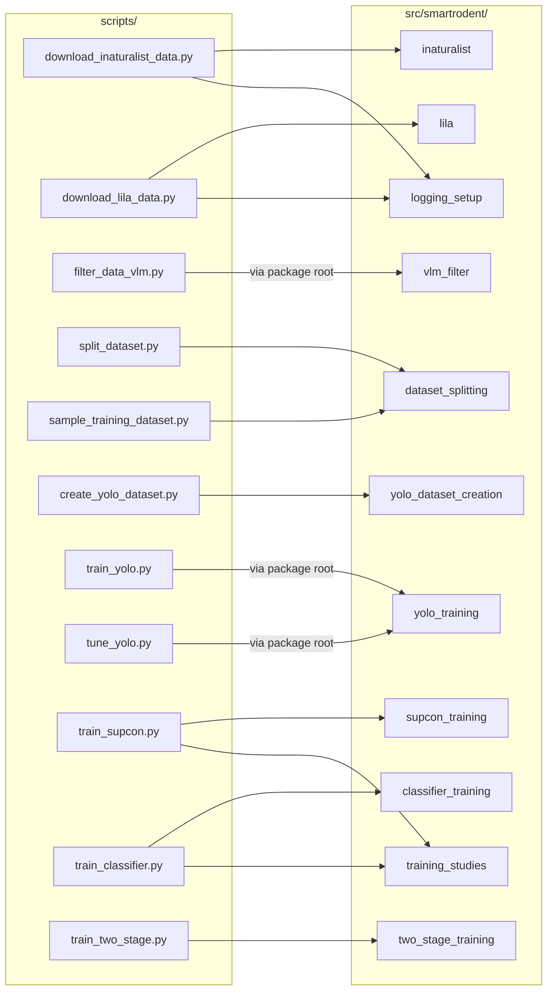
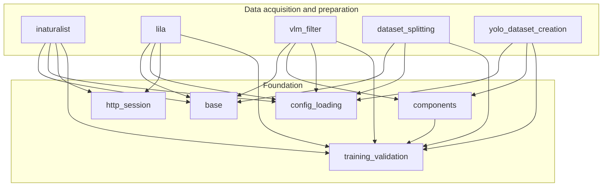
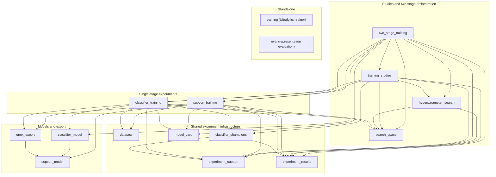
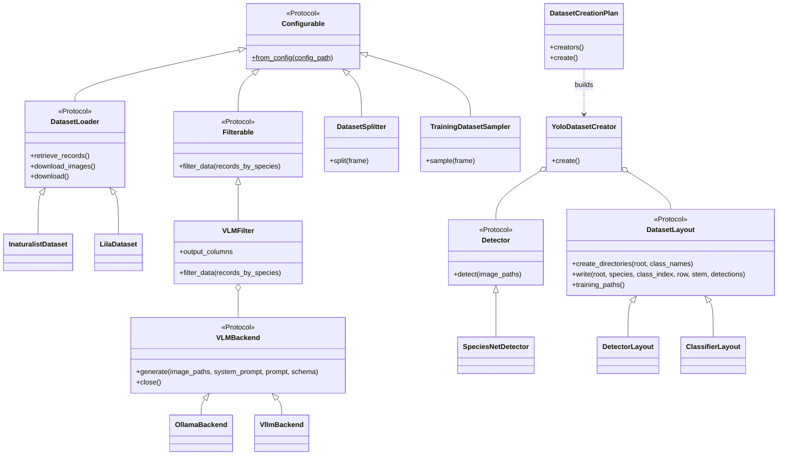
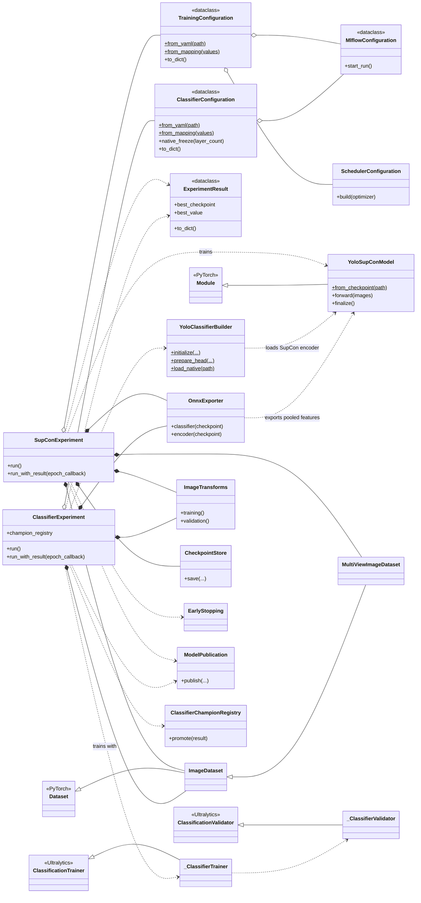
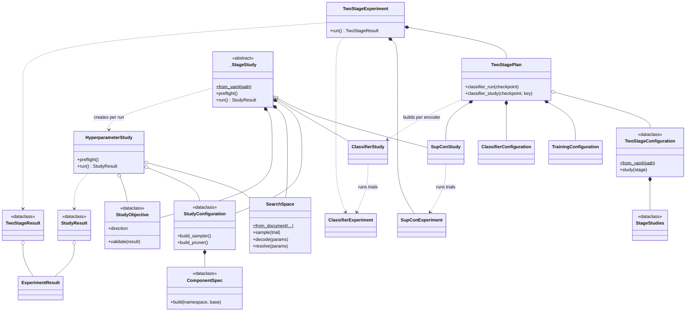
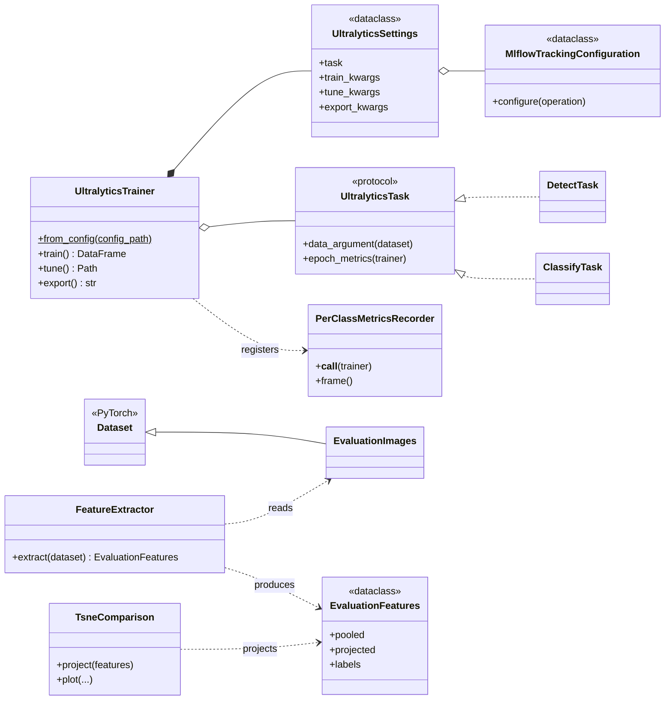

# SmartRodent experiments

Python tools for acquiring, reviewing, preparing, and learning from wildlife
images, with a focus on rodents, snakes, birds, and other small animals. The
repository contains an iNaturalist/LILA data workflow, SpeciesNet-assisted YOLO
dataset creation, an Ultralytics detector and classifier trainer, and independent PyTorch
supervised-contrastive (SupCon) and cross-entropy (CE) training workflows. The
SupCon and CE stages run either once or as Optuna hyperparameter studies; a grid
is a study over categorical choices.

## Contents

- [Installation](#installation)
- [Repository layout and library overview](#repository-layout-and-library-overview)
- [For developers: Project structure](#for-developers-project-structure)
- [CLI reference](#cli-reference)
- [Configuration guide](#configuration-guide)
- [Dataset workflow](#dataset-workflow)
- [Training workflows](#training-workflows)
- [Hyperparameter studies with Optuna](#hyperparameter-studies-with-optuna)
- [Checkpoints, results, and model cards](#checkpoints-results-and-model-cards)
- [DVC workflow](#dvc-workflow)
- [MLflow workflow](#mlflow-workflow)
- [Testing](#testing)
- [Troubleshooting and limitations](#troubleshooting-and-limitations)

## Installation

The project declares **Python >=3.12** in
[`pyproject.toml`](pyproject.toml) and uses [uv](https://docs.astral.sh/uv/).
Run commands from the repository root with the project installed in editable
mode in an activated virtual environment. `uv sync` installs this project in
editable mode by default.

For the CLI workflows documented here, install the `experiments` extra, which
provides DVC, MLflow, and Optuna:

```bash
uv sync --extra experiments
source .venv/bin/activate
```

For development and coverage reporting:

```bash
uv sync --extra experiments --extra dev
source .venv/bin/activate
```

The documented environment includes MLflow and Optuna even when tracking is
disabled and no study is configured: some package imports depend on them, and
the SupCon and classifier training scripts import the study modules. A
base-only `uv sync` does not select the `experiments` extra.

| Extra | Purpose |
| --- | --- |
| `experiments` | DVC, MLflow, and Optuna. |
| `dev` | pytest, Hypothesis, coverage, and test helpers. |
| `jupyter` | IPython kernel support for notebooks. |
| `ollama` | Ollama client extra; the client is also a runtime dependency. The Ollama server is separate. |
| `vllm` | Pinned local vLLM inference backend; needs a compatible GPU/software stack. |
| `all` | All declared extras, including the heavyweight inference backends. |

Add extras together when syncing an environment, for example
`uv sync --extra experiments --extra dev --extra jupyter`. The vLLM pin has a
resolver workaround documented in `pyproject.toml`:

```bash
# Optional: only for a workflow using the vLLM backend.
uv pip install "vllm==0.28.0" --torch-backend=auto
```

This may change the PyTorch stack; use a suitable environment rather than
installing every optional backend indiscriminately. Ollama-backed filtering
requires a running Ollama service. SpeciesNet, Ultralytics, and VLM workflows
may download model weights if they are not already available locally. CUDA
settings in the sample training configs require an available CUDA device;
choose `device: cpu` for CPU execution of the modern training workflows.

[`requirements_processing.txt`](requirements_processing.txt) and
[`requirements_ammico.txt`](requirements_ammico.txt) contain optional legacy
notebook/processing tools. They are not part of the main locked environment;
install one only when its separate workflow needs it.

## Repository layout and library overview

```text
configs/                 YAML parameters, training examples, model-card template
scripts/                 Executable workflow entry points
src/smartrodent/          Reusable Python library
notebooks/               Exploration and representation evaluation
tests/                   Unit, property-based, and opt-in integration tests
datasets/                Original images and intermediate/final datasets
dvc.yaml                 Declared data-processing and Ultralytics stage graph
pyproject.toml, uv.lock   Package metadata, extras, and dependency lockfile
```

Dataset directories and existing experiment outputs are not scratch space.
Choose output paths deliberately; direct scripts perform real writes, and
rerunning training in an existing directory can replace its active artifacts.

### Library map

Import reusable APIs from `smartrodent` modules, not executable scripts.

| Module(s) under `src/smartrodent/` | Responsibility and main APIs |
| --- | --- |
| [`inaturalist.py`](src/smartrodent/inaturalist.py) | `InaturalistDataset`: observation selection, licensed image acquisition, metadata, caching, and retries. |
| [`lila.py`](src/smartrodent/lila.py) | `LilaDataset`: license-aware camera-trap selection using LILA metadata and taxonomy. |
| [`vlm_filter.py`](src/smartrodent/vlm_filter.py) | `VLMFilter`, `OllamaBackend`, `VllmBackend`: annotate per-species image records with a VLM's schema-constrained answers without modifying originals. |
| [`dataset_splitting.py`](src/smartrodent/dataset_splitting.py) | `DatasetSplitter` and `TrainingDatasetSampler`: split metadata and sample training rows. |
| [`yolo_dataset_creation.py`](src/smartrodent/yolo_dataset_creation.py) | `YoloDatasetCreator` (split records + `SpeciesNetDetector` + `DetectorLayout`/`ClassifierLayout`); `DatasetCreationPlan` creates a list of datasets with one shared detector and layout. |
| [`datasets.py`](src/smartrodent/datasets.py) | `ImageDataset`, `MultiViewImageDataset`, `collate_views`: class mappings, image indexing, and two-view batching. |
| [`config_loading.py`](src/smartrodent/config_loading.py) | YAML loading with the study tags (`load_yaml`, `parse_yaml`) and plain section lookup (`load_section`). |
| [`components.py`](src/smartrodent/components.py) | `ComponentSpec`: a class or function chosen by name (or `module:attr`) plus its parameters, e.g. Optuna samplers or dataset creators. |
| [`training_validation.py`](src/smartrodent/training_validation.py) | Shared configuration schemas, parsing, serialization, and output/input path protections. |
| [`yolo_training.py`](src/smartrodent/yolo_training.py) | `UltralyticsTrainer` (`task: detect \| classify`): one wrapper around Ultralytics train/tune/export, with `UltralyticsSettings`, per-task strategies (`DetectTask`, `ClassifyTask`) and a `PerClassMetricsRecorder` that writes `per_class_metrics.csv`. |
| [`supcon_model.py`](src/smartrodent/supcon_model.py), [`supcon_training.py`](src/smartrodent/supcon_training.py) | `YoloSupConModel`, `TrainingConfiguration`, `SupConExperiment`. |
| [`classifier_model.py`](src/smartrodent/classifier_model.py), [`classifier_training.py`](src/smartrodent/classifier_training.py) | `YoloClassifierBuilder`, `ClassifierConfiguration`, `ClassifierExperiment`: explicit encoder/head initialization and native Ultralytics training with configurable layer freezing. |
| [`search_space.py`](src/smartrodent/search_space.py) | `SearchSpace`: named Optuna distributions declared by `!suggest-float`, `!suggest-int`, and `!suggest-categorical` tags, including `!coupled` values that follow a categorical choice; `reject_search_tags()` for single-run documents. |
| [`hyperparameter_search.py`](src/smartrodent/hyperparameter_search.py) | `HyperparameterStudy`, `StudyConfiguration`, `StudyObjective`, `StudyResult`: trainer-independent Optuna studies that run, rank, and report trials of one search space. |
| [`training_studies.py`](src/smartrodent/training_studies.py) | `SupConStudy`, `ClassifierStudy`, `is_study_configuration()`: bind `HyperparameterStudy` to the SupCon and classifier trainers, with one `trial_NNNN` directory per trial. |
| [`two_stage_training.py`](src/smartrodent/two_stage_training.py) | `TwoStageConfiguration`, `TwoStagePlan`, `TwoStageExperiment`: a SupCon run or study, encoder selection, then a classifier run or study. |
| [`experiment_support.py`](src/smartrodent/experiment_support.py), [`experiment_results.py`](src/smartrodent/experiment_results.py) | Transforms, schedulers, stopping, checkpoint storage, tracking/publication, and structured results. |
| [`onnx_export.py`](src/smartrodent/onnx_export.py) | `OnnxExporter`: ONNX export of CE classifiers (probabilities) and SupCon encoders (pooled features). |
| [`classifier_champions.py`](src/smartrodent/classifier_champions.py) | `ClassifierChampionRegistry`: provenance-aware historical comparison and promotion. |
| [`model_card.py`](src/smartrodent/model_card.py) | Template loading, training-card population, YAML/Markdown rendering and writing. |
| [`eval.py`](src/smartrodent/eval.py) | `EvaluationImages`, `FeatureExtractor`, `EvaluationFeatures`, `TsneComparison`: fixed-subset representation evaluation. |
| [`base.py`](src/smartrodent/base.py) | Shared protocols `Configurable`, `Filterable`, `DatasetLoader`; an implementation missing a method fails when it is created. |
| [`http_session.py`](src/smartrodent/http_session.py) | `retrying_session`: a `requests` session that retries 429/5xx responses and dropped connections, used by both downloaders. |
| [`logging_setup.py`](src/smartrodent/logging_setup.py) | `log_to_console_and_file`: the download scripts' console and log-file output; library classes add no handlers. |
| [`__init__.py`](src/smartrodent/__init__.py) | Convenience exports for filters and Ultralytics trainers. Experiment APIs are imported from their modules. |

Some data-processing scripts also contain workflow-specific pandas/file
operations. The modern training scripts delegate training to the library.

## For developers: Project structure

The diagrams below describe `src/smartrodent/` and the scripts that drive it.
They are derived from the package's import statements and class definitions;
update them when modules, public classes, or their relationships change.

### Module dependencies

Arrows point from the importing module to the imported module.

#### Scripts and their library entry points

Each script is a thin entry point that delegates to one or two library
modules. `reconcile_filtered_data.py`, `materialize_filtered_data.py`, and
`downsample_dataset.py` only use pandas and file operations and import nothing
from `smartrodent`.



#### Data acquisition and preparation modules

The downloaders, the VLM filter and the splitters implement a protocol from
`base`; all data modules read their settings through `config_loading.load_section`.
Settings are validated with types from `training_validation`. `vlm_filter` and
`yolo_dataset_creation` build their backend and detector through
`components.ComponentSpec`; both downloaders retry through `http_session`.



#### Training modules

Almost every training module imports `training_validation` (settings types
and parsing), and the orchestration and single-stage modules also import
`config_loading`. To keep the graph readable, those foundation edges are left
out here. `hyperparameter_search` additionally imports `components`.



`training_validation`, `config_loading`, `datasets`, `model_card`, and
`supcon_model` import nothing else from the package, so they are the safest places to
start reading.

### Class diagrams

Notation: `<|--` inheritance or protocol implementation, `*--` the owner
creates and keeps the part as an attribute, `o--` the owner keeps a part
built elsewhere, and `..>` creates temporarily, uses, or returns. `<<dataclass>>` marks frozen
dataclasses. Only the main public methods are listed. The
`TypedDict` settings schemas in `training_validation` are omitted.

#### Data acquisition and preparation

The `Configurable` protocol family in `base` defines the contracts. Scripts
build every data component with `from_config()`.



#### Single-stage experiments: SupCon and CE classifier

Each experiment is built from a frozen configuration dataclass and returns an
`ExperimentResult`. The SupCon stage runs its own PyTorch loop. The classifier
stage plugs custom subclasses into Ultralytics' native classification trainer.



#### Hyperparameter studies and two-stage training

Optuna studies sample a `SearchSpace` built from `!suggest-float`,
`!suggest-int`, and `!suggest-categorical` tags; `!coupled` values follow a
categorical choice. `_StageStudy` adapts the generic `HyperparameterStudy` to
one training stage. `TwoStagePlan` validates every stage candidate of a
`TwoStageConfiguration`, and `TwoStageExperiment` chains a SupCon stage (one run
or a study) into a classifier stage (one run or a study) through the selected
encoder checkpoint.



#### Ultralytics trainer and representation evaluation

These classes stand apart from the experiment framework above.
`UltralyticsTrainer` wraps Ultralytics detector or classifier training, tuning,
and export. The `eval` classes extract features from a fixed image subset and
compare them with t-SNE (see
[`notebooks/`](notebooks/)).



## CLI reference

### Invocation and arguments

Every script below takes **one required positional YAML path**, plus argparse's
`-h`/`--help` option:

```text
python scripts/<script>.py [-h] CONFIGURATION
```

The positional argument is named `config` in most help messages and
`configuration` in `train_classifier.py` and `train_two_stage.py`; its usage is
the same. There is no `--config` flag, installed `smartrodent` command, or general
command-line parameter-override interface. Set experiment parameters in YAML.

For help without starting a workflow:

```bash
python scripts/train_supcon.py --help
python scripts/train_classifier.py --help
python scripts/train_two_stage.py --help
```

Configuration paths and directory/weight paths inside configs are interpreted
relative to the **working directory**, not the YAML file's directory. The
examples assume the repository root. Metadata CSV image references follow a
different convention described under [portable dataset paths](#portable-dataset-paths).

### Acquisition and data preparation

For each row, invoke `python scripts/<script> configs/<configuration>`.
These commands download, infer, or write dataset artifacts; they are not
validation-only commands.

| Script | Configuration(s) under `configs/` | Input, operation, and output |
| --- | --- | --- |
| [`download_inaturalist_data.py`](scripts/download_inaturalist_data.py) | [`data_config_full.yaml`](configs/data_config_full.yaml), [`dataset_config_srilanka.yaml`](configs/dataset_config_srilanka.yaml) | Reads `data.inaturalist`; selects observations and downloads per-species `records.csv` and `imgs/` into `output_path`. |
| [`download_lila_data.py`](scripts/download_lila_data.py) | [`data_config_lila.yaml`](configs/data_config_lila.yaml) | Reads `data.lila`; caches index/taxonomy/dataset metadata and downloads selected camera-trap images into class directories. |
| [`filter_data_vlm.py`](scripts/filter_data_vlm.py) | [`filter_data_vlm_config_animal.yaml`](configs/filter_data_vlm_config_animal.yaml), [`filter_data_vlm_config_birds.yaml`](configs/filter_data_vlm_config_birds.yaml), [`filter_data_vlm_config_snakes.yaml`](configs/filter_data_vlm_config_snakes.yaml), [`filter_data_vlm_config_thermal.yaml`](configs/filter_data_vlm_config_thermal.yaml) | Reads species CSVs and source images; runs the selected Ollama/vLLM backend and writes task-labelled CSVs under `paths.output_root`. |
| [`materialize_filtered_data.py`](scripts/materialize_filtered_data.py) | [`materialize_filtered_data.yaml`](configs/materialize_filtered_data.yaml) | Partitions records by rejection flags; writes `kept/` and `rejected/` metadata and relative image symlinks for review. |
| [`reconcile_filtered_data.py`](scripts/reconcile_filtered_data.py) | [`reconcile_filtered_data.yaml`](configs/reconcile_filtered_data.yaml) | Reads original metadata and an already prepared human-corrected image tree; validates associations and writes `records_corrected.csv`. Does not perform the human review itself. |
| [`split_dataset.py`](scripts/split_dataset.py) | [`dataset_splitter.yaml`](configs/dataset_splitter.yaml) | Discovers per-species CSVs using `paths.records_glob`; assigns train/validation/test rows and writes per-species split metadata. |
| [`sample_training_dataset.py`](scripts/sample_training_dataset.py) | [`training_dataset_sampler.yaml`](configs/training_dataset_sampler.yaml) | Oversamples training rows using the script's custom rule; preserves non-training splits and saves metadata plus config/script snapshots. |
| [`downsample_dataset.py`](scripts/downsample_dataset.py) | [`downsample_dataset.yaml`](configs/downsample_dataset.yaml) | Alternative metadata operation: caps each species CSV at `max_images_per_class` using `rng_seed`; does not copy images. Not a declared DVC stage. |
| [`create_yolo_dataset.py`](scripts/create_yolo_dataset.py) | [`create_yolo_detector_dataset.yaml`](configs/create_yolo_detector_dataset.yaml), [`create_yolo_classifier_dataset.yaml`](configs/create_yolo_classifier_dataset.yaml) | Builds the configured `creator` once per `datasets` entry; runs SpeciesNet to write detector labels/source symlinks or classifier image crops into new destinations. |

Examples—choose the relevant command, rather than executing this block as an
unattended pipeline:

```bash
python scripts/download_inaturalist_data.py configs/data_config_full.yaml
python scripts/download_lila_data.py configs/data_config_lila.yaml
python scripts/filter_data_vlm.py configs/filter_data_vlm_config_animal.yaml
python scripts/materialize_filtered_data.py configs/materialize_filtered_data.yaml
python scripts/reconcile_filtered_data.py configs/reconcile_filtered_data.yaml
python scripts/split_dataset.py configs/dataset_splitter.yaml
python scripts/sample_training_dataset.py configs/training_dataset_sampler.yaml
python scripts/downsample_dataset.py configs/downsample_dataset.yaml
python scripts/create_yolo_dataset.py configs/create_yolo_classifier_dataset.yaml
```

### Training and tuning

These commands initialize models and start actual training. They do not expose
`--dry-run`, `--validate-only`, `--resume`, `--epochs`, or `--device` options.

| Command | Workflow and reported output |
| --- | --- |
| `python scripts/train_supcon.py configs/train_supcon_config.yaml` | One fresh standalone SupCon run, or an Optuna study; prints each final `last.pt` path and, for a study, the selected `best.pt`. |
| `python scripts/train_classifier.py configs/train_classifier_config.yaml` | One fresh standalone CE classifier run, or an Optuna study; prints final checkpoints and, for a study, the selected `best.pt`. |
| `python scripts/train_two_stage.py configs/train_two_stage_config.yaml` | SupCon run or study, encoder selection, then CE run or study; prints final classifier checkpoints and the selected classifier's `best.pt`. |
| `python scripts/train_yolo.py configs/train_yolo_detector_config.yaml` (or `train_yolo_classifier_config.yaml`) | Ultralytics training of the configured `task`, then the configured export; prints the export location. |
| `python scripts/tune_yolo.py configs/train_yolo_classifier_config.yaml` | Ultralytics `YOLO.tune` with the config's `tune_kwargs`; prints the tuning project directory. Never exports: the best weights and `best_hyperparameters.yaml` stay in the tuner's `<name or tune>[N]/` subdirectory of it (numbered on reruns). |

`train_supcon.py` and `train_classifier.py` run an Optuna study instead of the
single configured run when the configuration has a top-level `tuning` section;
without it, search tags are rejected. In
`train_two_stage.py`, the root `tuning` section chooses the stages that run as
studies. See [Hyperparameter studies with Optuna](#hyperparameter-studies-with-optuna).

The two Ultralytics scripts are separate from the modern SupCon/CE experiment
implementation. Each copies its config into the training or tuning project
directory before it runs; the device comes from `device` in the config.

## Configuration guide

The three modern training examples contain inline comments listing node
choices, types, and ranges:

- [`train_supcon_config.yaml`](configs/train_supcon_config.yaml): standalone SupCon.
- [`train_classifier_config.yaml`](configs/train_classifier_config.yaml): standalone CE, as a grid study over head settings.
- [`train_two_stage_config.yaml`](configs/train_two_stage_config.yaml): unified two-stage experiment.

These are different schemas from the standalone Ultralytics configs
[`train_yolo_detector_config.yaml`](configs/train_yolo_detector_config.yaml) and
[`train_yolo_classifier_config.yaml`](configs/train_yolo_classifier_config.yaml),
which use `task`, `train_kwargs`, `tune_kwargs`, and `export_kwargs`.

### Configuration families

| Family | Main structure/options |
| --- | --- |
| iNaturalist | `data.inaturalist`: `output_path`, species, years or year range, observation/license filters, caps, cache/retry settings. |
| LILA | `data.lila`: output path, index/taxonomy URLs, dataset-to-license mapping, allowed licenses, classes, cap, seed, `max_retries`/`backoff_factor`. |
| VLM filters | Input/output `paths`, optional `species`, and a `filter` section: `taskname`, `answer_schema` (its `label` enum defines the labels), prompts that cite it as `{answer_schema}`, column names, and `backend: {name, parameters}` (`OllamaBackend` or `VllmBackend`, whose `engine`/`sampling` pass through to vLLM). |
| Review materialization/reconciliation | Input/output paths, rejection-column prefix or corrected partition/column lists, accepted image suffixes. |
| Splitting/sampling/downsampling | Input/output metadata roots, record discovery, split/sampling rules, seeds, or per-class caps. |
| YOLO dataset creators | `detector: {name, parameters}` (`SpeciesNetDetector` or `module:Class`), `layout` (`detector` or `classifier`), `class_names`, `batch_size`, and a `datasets` list of `path_to_image_data`/`dataset_output_path` pairs. |
| Modern standalone training | Top-level data/output, transforms, validation, tracking, and model/initialization settings; SupCon uses AdamW options, CE uses native `train_kwargs`. |
| Two-stage training | Root `output_directory`, shared `data`, `supcon`, `classifier`, optional shared `mlflow`, and optional per-stage `tuning`. |
| Optuna studies | A standalone SupCon or CE configuration with `!suggest-*` tags plus a top-level `tuning` section; see [Hyperparameter studies with Optuna](#hyperparameter-studies-with-optuna). |
| Ultralytics trainer | `task` (`detect`/`classify`), `model`, `dataset`, native `train_kwargs`/`export_kwargs`, optional `tune_kwargs` (`iterations`, `space`, real overrides), and optional wrapper-specific `mlflow` settings. |
| Model cards | [`model_card_template.yaml`](configs/model_card_template.yaml): model, classes, validation, provenance, and editable narrative. |

### Search tags and coupled values

The training CLIs load configurations with `smartrodent.config_loading`, which
knows the study tags `!suggest-float`, `!suggest-int`, `!suggest-categorical`
and `!coupled`; plain `yaml.safe_load()` does not accept them. Tags require a
`tuning` section (in a two-stage document: `tuning.<stage>`); a configuration
without one is a single run, and a tag in it is an error.

A grid is a study over `!suggest-categorical` choices with
`sampler: {name: BruteForceSampler}`, which trains every combination once and
then stops. `!coupled` pairs values with a categorical's choices by position,
without adding an independent dimension:

```yaml
# Fragment within a standalone classifier configuration:
initialization:
  head:
    replace: !suggest-categorical
      choices: [linear, full]
    source: !suggest-categorical
      choices: [random, yolo_checkpoint]
    checkpoint: !coupled
      target: initialization.head.source
      values: [null, /path/to/species_classifier.pt]
```

This fragment describes four head combinations. Coupled lists have the same
length as their target's choices, and targets are full dotted paths from the
document root. In a two-stage document, the corresponding target is
`classifier.initialization.head.source`. Choices can be any YAML value,
including lists and mappings; Optuna stores the choice index, and reports show
the value. The stages of the two-stage workflow are searched independently;
classifier choices do not multiply SupCon training runs. See
[Hyperparameter studies with Optuna](#hyperparameter-studies-with-optuna).

### Shared modern training options

| Node | Choices/meaning |
| --- | --- |
| `transforms` | torchvision v2 keyword dictionaries; `image_size` is a positive square size. Augmentation `p` values range from 0 to 1. |
| SupCon `optimizer` | AdamW kwargs, including a positive `lr`; this is not an optimizer-name selector. |
| CE `train_kwargs` | Native Ultralytics training options such as `optimizer`, `lr0`, `lrf`, `cos_lr`, `warmup_epochs`, `patience`, and `amp`. Shared model/data/output/batch/device/seed, `freeze`, and `save_period` (only `best.pt`/`last.pt` are kept) cannot be overridden here. |
| `epochs`, `workers`, `seed`, `device` | Maximum epoch count, nonnegative loader worker count, integer seed in `[0, 2**32)`, and PyTorch device such as `cpu`/`cuda:0`. |
| `validation_dataset` | Existing class-folder validation split, or `null` for standalone training-only operation. Two-stage selection uses validation. |
| `validation_metrics` | Named sklearn metric specifications, or `null`. Each receives true/predicted labels, not probabilities. `function` names the metric; other entries are native kwargs. |
| `tracked_metric` | SupCon native loss statistic/custom alias, or CE's `ce_loss_mean`/custom alias. SupCon defaults to `supcon_loss_mean`; CE defaults to `ce_loss_mean`. |
| `tracked_mode` | `min`, `max`, or `null`/omitted for inferred loss-min/score-max direction. |
| SupCon `scheduler` | `null`/omitted for constant LR, or `name: ReduceLROnPlateau` with `parameters`. |
| SupCon `early_stopping` | `null`/omitted, or positive `patience`, nonnegative absolute `tolerance`, and `comparison: less`/`greater`. |
| `mlflow` | `null`/omitted, or tracking/registry settings described below. |
| `model_card_template` | Optional template path; defaults to `configs/model_card_template.yaml`. |
| `onnx_export` | `null`/omitted for no export, or a mapping with optional `dynamic` (default `false`: batch 1 at `image_size`; `true`: any batch and image size) and `simplify` (default `true`: onnxslim). `{}` exports with these defaults. The opset is not configurable; see [Sharing ONNX exports](#sharing-onnx-exports). |

Native SupCon validation statistics are `supcon_loss_min`,
`supcon_loss_mean`, `supcon_loss_std`, and `supcon_loss_max`; custom aliases
cannot replace them. CE reserves `ce_loss_mean` and native names `fitness`,
`val/loss`, `metrics/accuracy_top1`, `metrics/accuracy_top5`, `train/loss`, `epoch`,
`time`, and native learning-rate fields `lr/pgN` (integer group index). Sklearn
aliases cannot overwrite these fields. Metric specs can include `function: f1_score`,
`average: macro`, and `zero_division: 0`.

Use `min` for losses and `max` for scores where larger is better. SupCon's
scheduler mode and stopping `comparison: less`/`greater` must agree with that
direction. Its scheduler patience, stopping tolerance, and strictly improving
best-checkpoint selection retain their existing meanings. Without SupCon
validation, disable validation metrics/scheduling/stopping and leave
`tracked_metric`/`tracked_mode` omitted or null.

CE uses the configured objective as native fitness, including for native
stopping and best selection; it does not silently substitute top-1 accuracy.
`train_kwargs.patience: 0` disables stopping. Native best weights retain the
latest tied epoch within a run; study selection keeps the first tied trial. Training-only CE uses `ce_loss_mean`, not a validation metric alias.
CE `ce_loss_mean` on validation remains unweighted full-split mean cross-entropy,
separate from native `val/loss` batch aggregation or optional class weighting.

SupCon remains FP32. CE accepts native `amp` settings; the examples explicitly
use FP32. Both start fresh optimizer state. The scripts do not expose training
resumption, and CE rejects `train_kwargs.resume`. CE configures optimization
through native `train_kwargs` and the explicit `freeze` setting.

### Inspect configuration without training

There is no validation-only CLI flag, but the library configuration loaders
validate settings without constructing models or starting runs:

```python
from smartrodent.classifier_training import ClassifierConfiguration
from smartrodent.supcon_training import TrainingConfiguration
from smartrodent.two_stage_training import TwoStageConfiguration, TwoStagePlan

supcon = TrainingConfiguration.from_yaml("configs/train_supcon_config.yaml")
pipeline = TwoStageConfiguration.from_yaml("configs/train_two_stage_config.yaml")
plan = TwoStagePlan(
    pipeline
)  # validates every candidate; reads architectures and head donors, trains nothing
print(len(plan.supcon_configurations), len(plan.classifier_candidates))
```

`ClassifierConfiguration.from_yaml(path)` does the same for a single classifier
run.

Study configurations prevalidate the same way: `SupConStudy.from_yaml(path)` and
`ClassifierStudy.from_yaml(path)` from `smartrodent.training_studies` parse the
`tuning` section and search space and build every prevalidated candidate. They
do not open the Optuna storage or start trials. `is_study_configuration(path)`
reports whether a file has a `tuning` section.

Parsing is not a complete donor/architecture/device compatibility check. Creating
an experiment additionally prepares datasets, transforms, scorers, and templates;
model-dependent checks occur when actual models are initialized.

## Dataset workflow

### Acquisition and filtering

The iNaturalist downloader reads `data.inaturalist` and stores one species
folder with `records.csv` and `imgs/`. Choose species, observation years,
quality grade, allowed licenses, and download caps in its config. Configurations
are copied into outputs for provenance, and the script logs to the console and to
`inaturalist_dataset.log` in the output folder.

LILA uses dataset-level licenses and a taxonomy mapping to match configured
Latin taxa or raw labels such as `empty` and `vehicle`. Its image cap is per
class **and per LILA dataset**. Sequence-aware sampling uses the configured seed;
metadata is cached under the LILA output, and the script logs to
`lila_dataset.log` there. LILA has its own DVC download stage but
is not automatically merged into the iNaturalist filtering branch.

The animal, flying-bird, and snake VLM filters annotate metadata in sequence.
The thermal-filter config is an additional direct-script workflow, not a stage
in the current DVC graph. Backend selection, prompts, model names, batching, and
input/output paths come from each filter config. The answer schema is written once
in the config: the backend enforces it and the prompt cites it. Each label gets a
boolean column `<label>_<taskname>` (e.g. `kept_animal`); every other answer, such
as `needs_human_review`, is saved as `vlm_<taskname>_<field>`. Species outside a
config's `species` list pass through with `False` labels and empty answers.

Materialization exposes kept/rejected images through symlinks. Human review is
a separate step: prepare the corrected partition tree expected by the
reconciliation config, then reconcile it against the original records.
Reconciliation does not manufacture decisions or initialize that corrected tree.
Splitting consumes corrected metadata; oversampling operates on training rows
rather than resampling validation/test data. Keep held-out test data out of model
selection and champion comparisons.

### Portable dataset paths

Keep original image roots and stage directories as direct children of one
shared dataset root, normally `datasets/`. CSV `image_path` values are relative
to that root, for example `inaturalist/Mus musculus/imgs/123_0.jpg`, **not** to
the CSV or working directory.

Materialized review images and YOLO detector images use symlinks whose targets
are relative to each link's directory. Moving/copying the whole dataset tree
while preserving symlinks preserves those references; relocating one stage or
rearranging the internal tree does not. Update configured input/output paths
when relocating the tree.

Legacy absolute image references remain readable. Existing CSVs and symlinks
are not automatically converted, and there is no path-prefix migration utility.

### YOLO dataset creation and label order

A `YoloDatasetCreator` combines an input root's split records
(`load_split_records`, with optional `class_names`; `null` discovers species), a
detector (`SpeciesNetDetector` with its inference options) and a layout. The
`classifier` layout writes animal crops; the `detector` layout writes labels and
links to source images. Both preserve existing split assignments and oversampled
rows and require a new destination directory. One detector serves every dataset of
a configuration; its weights load lazily when inference is first needed, not
during configuration loading.

```python
from smartrodent.yolo_dataset_creation import DatasetCreationPlan

plan = DatasetCreationPlan.from_yaml("configs/create_yolo_classifier_dataset.yaml")
creators = plan.creators()  # reads and checks every dataset's records
# Explicitly writes dataset outputs and may download/load SpeciesNet weights:
# plan.create()
```

Ultralytics classification derives IDs from **alphabetically sorted species
folders under `train/`**, not `data.yaml`'s `names` order. Its classification
wrapper uses a YAML's `path` to locate the dataset. Detection instead uses the
class mapping in `data.yaml`. The modern image datasets also assign alphabetical
IDs for a supplied species list and reuse the established mapping in validation.
Interpret predictions using the model/checkpoint mapping, not the order in an
arbitrary input list.

## Training workflows

### Standalone SupCon

```bash
python scripts/train_supcon.py configs/train_supcon_config.yaml
```

`classes_per_batch` (P) selects distinct classes and `samples_per_class` (M)
selects source images per class: a batch contains P*M source selections and
2*P*M independently augmented views. `samples_per_epoch` counts source
selections and rounds down to complete batches. `dropout` and `output_features`
configure the projection head; `temperature` controls SupCon loss, and `freeze`
lists native YOLO layer indices to freeze.

Validation uses a fixed seeded P-K cohort with deterministic single-view
preprocessing and complete batches. Its loss statistics summarize validation
batches, not an exhaustive CE-style traversal of every image. SupCon optimizes
contrastive representations, not a CE classification objective; optional
classification metrics are diagnostics from the classifier outputs.

A single run writes directly to `output_directory`; a study writes one
`trial_NNNN` directory per trial and keeps the temperature fixed across trials.

### Standalone CE classifier

```bash
python scripts/train_classifier.py configs/train_classifier_config.yaml
```

The encoder format is explicit:

| `initialization.encoder.source` | `checkpoint` format |
| --- | --- |
| `supcon` | Standalone SmartRodent SupCon checkpoint. |
| `ultralytics` | Local native Ultralytics classification checkpoint. |

All supported encoder formats contain YOLO classification models, not arbitrary
Torch modules. Unsupported non-YOLO models raise `NotImplementedError`.
`head.replace: linear` replaces only the final linear layer.
`head.replace: full` replaces the entire native `Classify` block. Which layers
train is decided separately by `freeze`.

`head.source: random` uses native constructors, not a custom initialization
scheme. `yolo_checkpoint` copies only shape-compatible tensors from an explicit
native classifier donor into that fresh target head. It never transfers the
donor backbone. Class-name equality is not required, and rows are copied by
shape, not remapped semantically. A 1,000→26 full head can transfer its compatible
convolution/BatchNorm while leaving the output linear fresh. A linear-only
1,000→26 donor transfers no output weights: a warning before training flags its
equivalence to random linear initialization. All configured variants still run.
A random head accepts an omitted/null donor checkpoint.

`freeze` is required: a layer count N freezes layers `0..N-1` (Ultralytics'
convention), a list names unique layer indices, and `0`/`[]` trains everything.
The last layer is the `Classify` head; its index is only valid with
`replace: linear` and freezes the head convolution, so only Linear trains (for
YOLO26-cls, `freeze: 11` is a linear probe and `freeze: 10` freezes the encoder
under a trainable full head). Out-of-range values fail before training; in the
two-stage pipeline they fail before SupCon trains. Frozen layers stay in eval
mode, including Dropout. `encoder_batchnorm` is required when layers are frozen:
`eval` fixes their running statistics, `adapt` updates only those statistics. It
must be omitted (or null) when nothing is frozen. `train_kwargs.dropout` sets the
head's Dropout before Linear for every `replace` mode (native default 0.0); other
Dropout modules are not changed.
Configured torchvision augmentations remain the actual training transforms;
validation uses deterministic, unaugmented preprocessing. Dataset/cache-writing
native discovery and conflicting augmentation options are not used.

CE uses ordinary shuffled, single-view batches and retains the final partial
batch. Validation traverses the full split, computes sample-weighted mean CE,
and evaluates configured label metrics. Each run owns a fresh model and
optimizer. Without validation, standalone training is allowed but no champion
is selected; a study ranks trials by the configured objective and requires
validation.

A single run uses the output root; a study writes one `trial_NNNN` directory per
trial and a `study.yaml` report. Each run writes native `weights/best.pt`,
`weights/last.pt`, and `results.csv`.

### Two-stage SupCon → CE

```bash
python scripts/train_two_stage.py configs/train_two_stage_config.yaml
```

The root owns shared data, output root, and MLflow settings. `supcon` and
`classifier` contain their respective stage settings rather than copies of the
shared paths/classes. Two-stage orchestration owns classifier encoder binding;
standalone encoder source/path choices cannot override the selected winner.

Execution:

1. Validate both stages (`TwoStagePlan`): every SupCon candidate, every
   classifier candidate against a placeholder encoder, output paths, freeze
   settings against every SupCon model, head donors and card templates.
2. Train the SupCon run, or every trial of its study. Selection uses the
   configured validation metric and direction; a study keeps the scorer
   definition/options and temperature fixed across trials.
3. Select the winning **best-epoch** checkpoint, not its final `last.pt`.
4. Bind that selected encoder/checksum/provenance to the classifier run, or to
   every trial of its study, with fresh model/optimizer state per run.
5. Select the CE winner and, if registration is enabled, compare it with the
   historical champion only after every trial finishes publishing.

The two stages are not a cross-stage Cartesian product. With S SupCon trials and
C classifier trials, execution trains S SupCon models and C classifiers, not
S*C classifiers. Stage failures propagate rather than being skipped. Two-stage
selection uses existing validation data, never a test split. See
[Studies in the two-stage pipeline](#studies-in-the-two-stage-pipeline).

### Ultralytics trainer

`train_yolo.py` and `tune_yolo.py` delegate to Ultralytics through
`smartrodent.yolo_training`. One config describes one setup:

- `task: detect | classify` selects the dataset layout (`<dataset>/data.yaml` or
  `<dataset>/train`) and the per-class metrics.
- `train_kwargs` and `export_kwargs` are native Ultralytics arguments, passed
  under their own names. `project` and `optimizer` are required in
  `train_kwargs`, `format` in `export_kwargs`; `opset` is rejected, so
  Ultralytics exports with its own best ONNX opset. `data`, `model` and `task`
  are top-level settings and must not appear in the kwargs.
- `tune_kwargs` hold `iterations`, `space` (`name: [low, high]` or
  `[low, high, gain]`) and only the arguments that differ from `train_kwargs`;
  repeating a train value is an error. A `project` override gives the tuning
  its own directory.
- Argument names and types are validated at load time with Ultralytics' own
  checks, so a typo fails before any training starts.

Outputs follow native `project`/`name` settings, not the modern experiment
directory convention. A relative `project` is resolved against the working
directory (the repo root under DVC), not Ultralytics' own `runs` directory, so
it matches the DVC `outs`. The tuner writes into `<project>/<name or tune>`,
numbered (`<name>2`, ...) when that exists. Training also writes `per_class_metrics.csv`
(precision, recall, F1 and support per class and epoch, plus `macro_f1`) into the
run directory; classes without validation samples or predictions are NaN, not 0.
The trainer uses a different MLflow schema and does not implement the modern
classifier champion-comparison workflow. An instance trains or tunes once.

## Hyperparameter studies with Optuna

The SupCon and CE stages can sample their settings with
[Optuna](https://optuna.org/). A study configuration is an ordinary stage
configuration. Some of its values are replaced by search tags, and a `tuning`
section holds the study settings. Each trial resolves the tags to one concrete
configuration, trains it with the existing trainer, and is ranked by that
trainer's tracked metric and mode.

[`train_classifier_config.yaml`](configs/train_classifier_config.yaml) is a
grid study over head settings. For a sampled study, add tags and a `tuning`
section to a copy of
[`train_supcon_config.yaml`](configs/train_supcon_config.yaml) or
[`train_classifier_config.yaml`](configs/train_classifier_config.yaml):

```yaml
# Fragments within a standalone SupCon configuration:
optimizer:
  lr: !suggest-float {low: 1.0e-5, high: 1.0e-3, log: true}
dropout: !suggest-categorical {choices: [0.0, 0.1, 0.3]}

tuning:
  study_name: supcon-lr-dropout
  storage: sqlite:///optuna.db  # null = in-memory, cannot be resumed
  n_trials: 20                  # Trials to run in this invocation.
  sampler:
    name: TPESampler
    parameters: {seed: 42}
  pruner:                       # null = never prune
    name: MedianPruner
    parameters: {n_warmup_steps: 3}
  load_if_exists: true          # Optional, default false.
  timeout: null                 # Optional wall-clock budget in seconds.
```

```bash
python scripts/train_supcon.py path/to/supcon_study.yaml
python scripts/train_classifier.py path/to/classifier_study.yaml
```

### Search tags

Parameters are named by their full dotted path, for example `optimizer.lr` or
`transforms.random_resized_crop.scale[0]`.

| Tag | Settings | Optuna call |
| --- | --- | --- |
| `!suggest-float` | `low`, `high`, optional `step` and `log` | `trial.suggest_float` |
| `!suggest-int` | Integer `low`, `high`, optional `step` and `log` | `trial.suggest_int` |
| `!suggest-categorical` | `choices`: a nonempty list of unique YAML values, including lists, mappings and `null` | `trial.suggest_categorical` over the choice indices |
| `!coupled` | `target`: full dotted path of a `!suggest-categorical`; `values`: one per choice | None. The value follows the target's sampled choice. |

Settings are strict. Booleans or fractional values for integer bounds,
nonfinite bounds, unknown keys, and a range that is not a multiple of `step`
are rejected, not coerced. A study needs at least one `!suggest-*` tag. A tag
stands for one setting: it cannot replace a whole configuration section, and no
tag can appear inside a categorical choice or a coupled value. A grid study uses
only categorical tags and `sampler: {name: BruteForceSampler}`, which runs every
combination once and then stops; set `n_trials` to at least the number of
combinations. For example, a classifier study can tie `freeze` to a sampled head
mode:

```yaml
initialization:
  encoder: {source: supcon, checkpoint: runs/supcon/best.pt}
  head:
    replace: !suggest-categorical {choices: [linear, full]}
    source: random
    checkpoint: null
freeze: !coupled
  target: initialization.head.replace
  values: [11, 10]
```

Settings that define comparability or locations cannot be searched:
`tracked_metric`, `tracked_mode`, `validation_metrics`, `train_dataset`,
`validation_dataset`, `class_names`, `output_directory`, and `mlflow`. SupCon
studies also keep `temperature` fixed. A study requires `validation_dataset`,
because trials are ranked on validation data. Model, encoder, head and template
files of every trial must lie outside the study's `output_directory`, where
trials write their artifacts.

### The `tuning` section

| Key | Meaning |
| --- | --- |
| `study_name` | Optuna study name; also the resume key in persistent storage. |
| `storage` | Optuna storage URL such as `sqlite:///optuna.db`, or `null` for an in-memory study. Relative SQLite paths depend on the working directory. |
| `n_trials` | Positive number of trials to run in this invocation; a resumed study adds that many. |
| `sampler` | `name` of a concrete class in `optuna.samplers` and its constructor `parameters` (default `{}`). |
| `pruner` | `name` of a class in `optuna.pruners` with `parameters`, or `null` to never prune. |
| `load_if_exists` | Optional, default `false`. Resume an existing study of the same name instead of failing. |
| `timeout` | Optional positive seconds. Optuna starts no new trial after this budget. |

Sampler and pruner settings are constructed while the configuration loads, so
a wrong name or parameter fails before any training.

### Prevalidation, trials, and selection

Before the first trial, the study builds a reference configuration with every
parameter at its first choice or low end. It then builds one candidate per other
choice or high end, varying one parameter at a time. An invalid bound or choice
therefore fails immediately and names the parameter. Invalid *combinations* of
individually valid values are found only when sampled.

Each trial trains in its own `trial_NNNN` directory under `output_directory`.
After each epoch the trainer reports its tracked validation value to the
pruner, so a configured pruner can stop unpromising trials early.

| Trial outcome | Effect |
| --- | --- |
| Completed | Ranked by the configured tracked metric and direction. |
| Pruned | Recorded as `PRUNED`; the study continues. |
| Invalid sampled combination, for example a freeze that does not fit the head | Recorded as `FAIL` with its error; the study continues. |
| Nonfinite loss or tracked metric (`FloatingPointError`) | Recorded as `FAIL`; the study continues. |
| Any other error | Recorded as `FAIL`, `study.yaml` is written, and the error stops the study. |

The winner is the best completed trial over the whole study, including trials
from earlier invocations; exact ties keep the earliest trial. A study with no
completed trial raises an error. `study.yaml` in `output_directory` is rewritten
after every trial. It lists each trial's number, state, sampled parameters,
value, intermediate values, result, and error, plus the selected trial.
Reported parameters are the sampled values; for categorical parameters, Optuna's
own storage holds the choice index.

```text
<output_directory>/
  study.yaml
  trial_0000/        # Same artifacts as one standalone SupCon or CE run
  trial_0001/
  ...
```

### Resuming a study

With persistent `storage` and `load_if_exists: true`, rerunning the same
configuration resumes the study and runs another `n_trials`. A resumed study
must match what was recorded when it was created. Otherwise it is refused, and
you need a new `study_name` and `output_directory`:

- the search space (distributions, categorical choice values, and couplings),
- the objective: tracked metric, mode, and resolved validation path,
- the stored optimization direction,
- for classifier studies, the SHA-256 of every encoder checkpoint, so moving an
  unchanged file is allowed.

An existing study with `load_if_exists: false` is refused rather than extended.
An `output_directory` whose `study.yaml` names another study is also refused,
because its trial directories would be overwritten.

### Studies in the two-stage pipeline

The two-stage root accepts a `tuning` mapping with one optional entry per
stage. A stage named there runs as a study. An omitted stage runs once and
must not contain search tags, and an empty `tuning` mapping is an error. Stage
sections must not contain their own `tuning` key.

```yaml
classifier:
  initialization:
    encoder:
      source: selected_supcon
    head:
      replace: !suggest-categorical {choices: [linear, full]}
      source: random
      checkpoint: null
  freeze: !coupled
    target: classifier.initialization.head.replace  # Full path from the root.
    values: [11, 10]
  train_kwargs:
    lr0: !suggest-float {low: 1.0e-4, high: 1.0e-2, log: true}
  # ... remaining classifier settings ...

tuning:
  classifier:  # Add supcon: for a SupCon study; an omitted stage runs once.
    study_name: two-stage-classifier
    storage: sqlite:///optuna.db
    n_trials: 10
    sampler: {name: TPESampler, parameters: {seed: 42}}
    pruner: null
```

- A single SupCon run writes to `<output_directory>/supcon/`; a SupCon study
  writes `study.yaml` and `trial_NNNN/` there. The winning `best.pt` becomes the
  encoder.
- A classifier study is keyed by the selected encoder. It runs in
  `<output_directory>/classifier/<key>/` under the study name
  `<study_name>-<key>`, where `<key>` is the first 12 hex characters of the
  encoder's SHA-256. A new SupCon winner therefore starts a fresh classifier
  study, and an unchanged winner can resume its own.
- SupCon-study storage and output conflicts are checked before any training.
  One case still fails late: a persistent classifier study with
  `load_if_exists: false` whose rerun selects the same encoder fails only after
  SupCon has trained.
- Inputs of every classifier trial must lie outside
  `<output_directory>/classifier/`, because the study directory is only known
  once SupCon has selected the encoder.

### Studies and MLflow

With `mlflow` configured, a standalone study opens one parent run, named after
its `output_directory`. Each trial is a nested child run. The parent logs
`study.yaml` and a `best_validation_<tracked_metric>` metric. In the two-stage
pipeline, trials are children of the pipeline run instead.

With a classifier registry configured, every completed trial registers its
model. Only the study winner is compared against the
champion alias, after all trials, using the
[promotion rules](#registration-and-classifier-champion-promotion). SupCon
trials follow standalone SupCon registration semantics. Two-stage SupCon trials
are never registered.

## Checkpoints, results, and model cards

### Modern experiment artifacts

| Artifact | SupCon | Native CE |
| --- | --- | --- |
| Concrete owned configuration | `config.yaml` | `config.yaml` plus native `args.yaml` |
| Epoch history | `history.yaml` | `results.csv` and checkpoint `train_results` |
| Latest weights | `last.pt` | `weights/last.pt` |
| Selected best weights | `best.pt` | `weights/best.pt` |
| Selected snapshot cards | `best.model_card.yaml` / `.md` | `weights/best.model_card.yaml` / `.md` |
| ONNX export (with `onnx_export`) | `best.onnx` (pooled encoder features) | `weights/best.onnx` (class probabilities) |

SupCon checkpoints embed architecture/state, label mapping, configuration,
optimizer and optional scheduler state. Its history exposes `learning_rate`
and `next_learning_rate`. CE saves complete native classification modules with
native `.names` and encoder-selection `.provenance`. Native finalization strips
optimizer state and sets checkpoint `epoch` to `-1`; use the selected result,
selection summary or card for the best epoch, not the full history length.
Periodic CE snapshots are available through native `train_kwargs.save_period`.
Saved optimizer metadata does not imply a supported resume CLI.

For a two-stage experiment with a SupCon study and a single classifier run:

```text
<output_directory>/
  config.yaml
  selection.yaml
  supcon/
    study.yaml
    trial_0000/              # One directory per SupCon trial
      config.yaml
      history.yaml
      last.pt
      best.pt
      best.onnx              # Only with onnx_export
      best.model_card.yaml
      best.model_card.md
    trial_0001/
      ...
  classifier/                # A single classifier run
    config.yaml
    args.yaml
    results.csv
    weights/
      best.pt
      best.onnx              # Only with onnx_export
      last.pt
      best.model_card.yaml
      best.model_card.md
```

A single SupCon run writes its artifacts directly under `supcon/`. A classifier
study writes `study.yaml` and `trial_NNNN/` under `classifier/<encoder key>/`.
Selection summaries identify the results of the current invocation, including
winning paths, scores, and selected-encoder identity; selection does not scan
old checkpoints to infer a winner. Completed artifacts/registry versions may
remain after a later failure. Use a fresh output root for a new experiment and
do not write concurrently to one run directory.

SupCon publishes checkpoints atomically per file and uses hard links for
`best.pt`; its filesystem must support them. CE uses the native checkpoint
writer/finalization. Neither is a transaction across all artifacts or provides
power-loss durability guarantees; arbitrary old outputs are not pruned.

### Reloading without the original starting weights

SupCon and new native CE checkpoints reload without the original starting
weights or notebook session:

```python
from ultralytics import YOLO
from smartrodent.supcon_model import YoloSupConModel

supcon = YoloSupConModel.from_checkpoint(
    "runs/supcon_standalone_xl_srilanka_lr-00001/best.pt", device="cpu"
)
classifier = YOLO(
    "runs/classifier_xl_srilanka/trial_0000/weights/best.pt", task="classify"
).to("cpu")
print(classifier.names)  # Integer ID -> species name.
# classifier(...) uses the native prediction API.
# classifier.model in eval mode returns (probabilities, logits).
supcon.finalize()  # Release the SupCon feature hook when finished.
```

CE weights are native Ultralytics checkpoints: they load with encoder
`source: ultralytics` and can serve as native head donors. Pickled checkpoints
must come from trusted sources and require compatible installed
PyTorch/Ultralytics/library versions.

### Sharing ONNX exports

With `onnx_export` set, every run exports its selected `best.pt` to ONNX next
to it, before any MLflow publication; a failed export, including a failed
onnxslim simplification, fails the run and leaves no ONNX file. A recipient
needs only `onnxruntime`, `numpy`, and an image library, not PyTorch,
Ultralytics, or this package.

| | CE classifier `weights/best.onnx` | SupCon `best.onnx` |
| --- | --- | --- |
| Exporter | Ultralytics' native ONNX export | Ultralytics' `torch2onnx` on the pooled encoder |
| Input | `images` | `images` |
| Output | `output0`: softmax class probabilities, N x classes | `embeddings`: pooled encoder features (before the projector), N x `embedding_dim` |
| Metadata | Ultralytics' `names`, `imgsz`, and more | `imgsz`, `embedding_dim`, `checkpoint_sha256` of `best.pt`, `input` |

Both expect the same input: RGB, float32 in `[0, 1]`, N x 3 x S x S, with S
from the `imgsz` metadata. Resize (stretch, not crop) to S x S; there is no
mean/std normalization. Training resizes with torchvision, so another resize
implementation can shift outputs slightly. Without `dynamic: true`, N is fixed
at 1. Both use Ultralytics' default opset for the installed PyTorch (currently
18), so the two files always agree.

```python
import ast
import numpy as np
import onnxruntime
from PIL import Image

session = onnxruntime.InferenceSession(
    "weights/best.onnx", providers=["CPUExecutionProvider"]
)
metadata = session.get_modelmeta().custom_metadata_map
height, width = ast.literal_eval(metadata["imgsz"])
image = Image.open("mouse.jpg").convert("RGB").resize((width, height), Image.BILINEAR)
batch = (np.asarray(image, dtype=np.float32).transpose(2, 0, 1) / 255)[None]
(output,) = session.run(None, {"images": batch})
names = ast.literal_eval(metadata["names"])  # CE classifier only.
print(names[int(output.argmax(axis=1)[0])])
```

For library-driven execution, use `SupConExperiment(configuration).run_with_result()`,
`ClassifierExperiment(configuration).run_with_result()`,
`SupConStudy.from_yaml(path).run()`, `ClassifierStudy.from_yaml(path).run()`, or
`TwoStageExperiment(configuration).run()`. These **execute training**. Studies
return a `StudyResult` with every completed trial result and the selected one. The
single-experiment `run()` methods return `last.pt`; structured results expose
best/last paths, best epoch/value, tracked metric/direction, validation identity,
and tracking information.

### Model cards and representation evaluation

[`configs/model_card_template.yaml`](configs/model_card_template.yaml) supplies
editable narrative and the `model`, `validation`, and `provenance` mappings.
Training populates class mappings, selected checkpoint identity/epoch/SHA-256,
validation results, Git commit, optional dataset revision, encoder provenance,
and available MLflow run/model/version IDs. Optional tracking/data identifiers
remain `null` when unavailable. Narrative fields are preserved; `model_card_template` selects another
compatible template.

Cards are saved beside `best.pt`. Tracking uploads best-model artifacts; registry
publication also attaches cards to the logged model and uses the Markdown as
the model-version description. A Git commit tag identifies HEAD, not a snapshot
of uncommitted source changes.

Generic rendering is also available independently:

```python
from pathlib import Path
from smartrodent.model_card import load_card_template, render_model_card

card = load_card_template(Path("configs/model_card_template.yaml"))
card["model"]["name"] = "rodent-species"
markdown = render_model_card(card)
```

[`notebooks/supcon_training.ipynb`](notebooks/supcon_training.ipynb) uses the
library evaluation helpers to compare pretrained pooled, trained pooled, and
trained projected representations on the same balanced image subset. Set its
checkpoint/data paths to the experiment being inspected.

## DVC workflow

### Declared graph versus current example paths

[`dvc.yaml`](dvc.yaml) declares the iNaturalist processing branch and an
independent LILA download:

```text
download_inaturalist
  -> filter_animal -> filter_flying_bird -> filter_snake
  -> materialize_filtered_data -> reconcile_filtered_data
  -> split_dataset -> sample_training_dataset
       -> create_yolo_detector_dataset
       -> create_yolo_classifier_dataset

train_yolo_detector, train_yolo_classifier, tune_yolo_classifier
  (read the stage-8 `_srilanka` dataset roots named in their configs)

download_lila  (independent)
```

Classifier training (SupCon, CE, two-stage) is not a DVC stage: DVC tracks
data, while MLflow tracks training runs and models.

**The graph is not currently a guarantee that all supplied config paths line
up.** Several configs target Sri Lanka directories ending in `_srilanka`, while
DVC declares unsuffixed paths. For example, `filter_animal` declares
`datasets/inaturalist`/`datasets/stage1_filtered_animal`, but its YAML reads
`datasets/inaturalist_srilanka` and writes
`datasets/stage1_filtered_animal_srilanka`. The detector-creation config
currently reads stage 6 and writes `stage8_yolo_detector_not_oversampled`,
whereas its DVC stage declares a stage-7 dependency and `stage8_yolo_detector`
output. Align configs and stage `deps`/`outs` for the intended dataset before
reproduction; DVC does not rewrite paths inside YAML for you.

The three modern training scripts (`train_supcon.py`, `train_classifier.py`,
`train_two_stage.py`), downsampling, and thermal filtering **do not currently
have DVC stages**. Execute those directly or explicitly add a suitable stage
when integrating them; do not assume `dvc repro` runs them.

### Inspect, reproduce, and share

Inspect the declared graph/status without executing its stages:

```bash
dvc dag
dvc status
```

Once paths, inputs, backends, and the manual-review outputs are ready, reproduce
one desired target:

```bash
# Executes the target and required out-of-date upstream dependencies.
dvc repro train_yolo_detector
# Or just the configured acquisition target and its dependencies:
dvc repro download_lila
```

`dvc repro` is not a dry run. It can download large datasets/weights, run VLM or
SpeciesNet inference, replace managed outputs, and train/export models. A bare
`dvc repro` considers the whole declared pipeline, including both download
branches and detector training. Human decisions needed by reconciliation must
already exist; automatic reproduction cannot replace review.

DVC uses declared dependencies, parameters, output hashes, and a generated
`dvc.lock` to decide what needs reproduction or restoration from cache. The
download stages declare YAML parameter sections; most other stages list their
whole config as a dependency. Only declared dependencies are tracked, so code
changes outside a stage's listed files are not automatically complete
invalidation signals.

With an intentionally configured remote, `dvc push` uploads cached outputs and
`dvc pull` restores them. These are explicit transfer/write operations, not
inspection commands. Keep remote credentials out of Git. Version the intended
source/configuration/DVC metadata separately from large image/model artifacts;
DVC caching and MLflow tracking have distinct roles. Shared remote definitions
can live in `.dvc/config`; keep machine-specific credentials in environment or
local configuration such as `.dvc/config.local`, not committed metadata. This
README does not assume a remote is configured.

## MLflow workflow

### Configure tracking and open the UI

Modern SupCon, CE, and two-stage configs accept:

```yaml
mlflow:
  tracking_uri: sqlite:///mlflow.db
  experiment_name: rodent-experiments
  registered_model_name: rodent-classifier  # null disables registry publication
  model_artifact_name: classifier
  champion_alias: champion
  dataset_revision: null  # Optional immutable input-data revision
```

Omit `mlflow` or set it to `null` to disable tracking/publication. With tracking
on and `registered_model_name: null`, run metrics and best-model artifacts are
still logged. Use an HTTP(S) tracking-server URI instead of SQLite when working
with a remote service. Keep authentication in the environment/service setup,
not committed configuration files.

From the same working directory used for a relative SQLite URI, start the local
UI in another activated terminal:

```bash
mlflow ui --backend-store-uri sqlite:///mlflow.db --host 127.0.0.1 --port 5000
```

Open <http://127.0.0.1:5000>. A local SQLite backend does not require a separate
server for training to log to it. Starting the UI/server can initialize backend
files. `mlflow.db` holds tracking/registry metadata; artifact payloads live in
the backend's artifact store, not inside the database. Preserve both when moving
or backing up experiments. Relative database/artifact locations depend on the
working directory.

### Run ownership and logged data

- **Standalone SupCon or CE run:** one root run.
- **Two-stage:** one pipeline parent with SupCon and classifier child runs.
  The parent logs configuration/selection summaries; children log stage metrics
  and selected best-model artifacts. SupCon children are encoder candidates,
  not registered CE classifier versions.
- **Optuna study:** standalone, one study parent run with one child run per
  trial. In the two-stage pipeline, trials are children of the pipeline run. See
  [Studies and MLflow](#studies-and-mlflow).

Runs record stage-specific parameters and epoch metrics, selected best values
and epochs, source Git/data tags, and best checkpoint/cards (plus `best.onnx` with `onnx_export`). CE metrics use
`training/ce_loss_mean` and `validation/<metric>`; SupCon records native training
loss statistics, validation metrics, and current/next learning rates. Local
`config.yaml` and SupCon `history.yaml` / CE `results.csv` remain useful independently of the tracking UI.

Modern experiments own their MLflow run contexts. An unrelated active run or
`MLFLOW_RUN_ID` requesting implicit resumption is rejected rather than silently
reused. A supplied `dataset_revision` is recorded, not automatically discovered
from DVC; set it deliberately when comparing versioned input data.

### Registration and classifier champion promotion

Modern CE publication and ranking are separate:

1. Each run's or trial's selected `best.pt` is restored and published as a
   registered model version, with completed cards and comparison metadata.
2. A study defers alias movement until **all** trials have trained and
   published successfully. A trial failure that stops the study prevents
   promotion of a partial winner; already created runs/versions are not rolled
   back.
3. The local validated winner is compared with the version currently referenced
   by `champion_alias`. If no incumbent exists, the validated winner can become
   the champion.
4. Historical comparison requires matching metric name, exact scorer/options,
   direction, resolved validation-split path, canonical class population,
   validation status, and dataset revision (including whether it is absent).
5. Promotion requires **strict improvement**. A historical tie retains the
   incumbent. Missing/legacy/incompatible metadata raises an error instead of
   silently overwriting the alias. Choose another model/alias or explicitly
   resolve the historical metadata when that is intended.

Training-only CE runs can be registered but are not promoted as validated
champions. The pipeline's `selection.yaml` and a classifier study's `study.yaml`
distinguish the local winner from the retained or
promoted registered champion; the best model in this invocation need not beat
the historical one. Remote publication is not transactional across model
version creation, artifact upload, metadata, and alias updates.

Standalone **SupCon registration has different semantics**: it publishes each
run's best model and assigns the alias for validated runs, without CE's strict
historical comparison or study-wide deferred promotion. Use separate registry
names for encoders and final CE classifiers. Two-stage orchestration disables
SupCon registration and applies the CE policy to classifier candidates only.

### Ultralytics trainer tracking

The `train_yolo.py` and `tune_yolo.py` scripts use this distinct schema:

```yaml
mlflow:
  tracking_uri: sqlite:///mlflow.db
  train_experiment_name: yolo-training
  tune_experiment_name: yolo-tuning
```

The trainer selects the operation's experiment, sets MLflow process settings,
and enables Ultralytics' MLflow integration; without an `mlflow` section it
switches that integration off. Its native callbacks/logging and
output/export behavior are separate from the modern model-card/champion
workflow; the modern registry fields do not belong in this mapping.

## Testing

Install the development and experiment extras, activate the environment, and
run from the repository root. For the ordinary isolated suite with line and
branch coverage, excluding live integration markers:

```bash
pytest -q -m 'not network and not vlm_integration and not speciesnet_integration' \
  --cov=smartrodent --cov-report=term-missing --cov-branch
```

For a line-coverage-only report, omit `--cov-branch`. Hypothesis is a first-class
part of the tests. A bare `pytest` includes network-marked tests unless they are
explicitly deselected; it does not execute the full DVC production pipeline.

| Marker | Execution requirements |
| --- | --- |
| `network` | Live API/network tests; select with `pytest -m network`. |
| `vlm_integration` | Real Ollama/vLLM inference; opt in with `SMARTRODENT_RUN_VLM_INTEGRATION=1 pytest -m vlm_integration`. Use `-k ollama` or `-k vllm` to select a backend. |
| `speciesnet_integration` | Real SpeciesNet inference; opt in with `RUN_SPECIESNET_INTEGRATION=1 pytest -m speciesnet_integration`. `SPECIESNET_MODEL` can select local weights. |

VLM tests accept `SMARTRODENT_OLLAMA_MODEL`, `SMARTRODENT_VLLM_MODEL`,
`SMARTRODENT_VLLM_GPU_MEMORY_UTILIZATION`, `SMARTRODENT_VLLM_MAX_MODEL_LEN`,
`SMARTRODENT_VLLM_MAX_NEW_TOKENS`, `SMARTRODENT_INTEGRATION_RODENT_IMAGE`, and
`SMARTRODENT_INTEGRATION_EMPTY_IMAGE` overrides. Integration tests can download
weights and use substantial GPU resources; enable them intentionally.

## Troubleshooting and limitations

| Symptom | Check |
| --- | --- |
| Package/module import fails | Activate the editable project environment; include `experiments` for the documented CLI environment, even if tracking is disabled. |
| Config or input path is not found | Run from the repository root or use appropriate absolute paths; paths are not rebased to the YAML directory. Sample configs refer to existing local datasets/checkpoints, not bundled assets. |
| Unknown YAML tag | Only the training CLIs/library loaders accept the study tags (`!suggest-*`, `!coupled`); other scripts and tags are plain YAML. |
| Dataset class is missing/empty | Verify exact species-directory names, selected population, split paths, and indexed suffixes. Modern datasets default to `.jpg` and `.png`. |
| Head transfer or checkpoint loading fails | Match source format, donor dimensions, and exact labels/IDs. Starting ImageNet weights are not automatically valid species-head donors. |
| CUDA/backend failure | Check installed hardware/runtime and modern `device` settings; the Ultralytics scripts take the device from `device` in the config and do not mask GPUs. |
| Search tag rejected with "add a tuning section" | A configuration without `tuning` (two-stage: without a `tuning` entry for that stage) is a single run. Add the section or replace the tags with values. |
| Study refuses to start or resume | The `study_name` already exists without `load_if_exists: true`, or its stored search space, objective, direction, or encoder checksums differ. Use a new `study_name` and `output_directory`. |
| Study ends with no completed trial | Inspect each trial's `state` and `error` in `study.yaml`; pruned and failed trials are never selected. |
| No validated winner or champion | Check validation configuration; training-only results are not validated candidates. |
| Champion metadata rejected | Compare scorer/options, split identity, labels, direction, and revision; do not erase provenance simply to force promotion. |
| DVC reports missing outputs or ignores a changed input | Compare the script's configured paths with declared `deps`/`outs` and listed code dependencies; current example configs and graph are not fully aligned. |
| Rerun replaced outputs or failed after partial publication | Use a new output root; inspect the current summary, completed artifacts, and tracking runs. There is no automatic resume or cross-artifact/registry rollback. |
| Checkpoint best-state publication fails on a filesystem | Modern checkpoint storage requires hard-link support and a single writer per run directory. |
